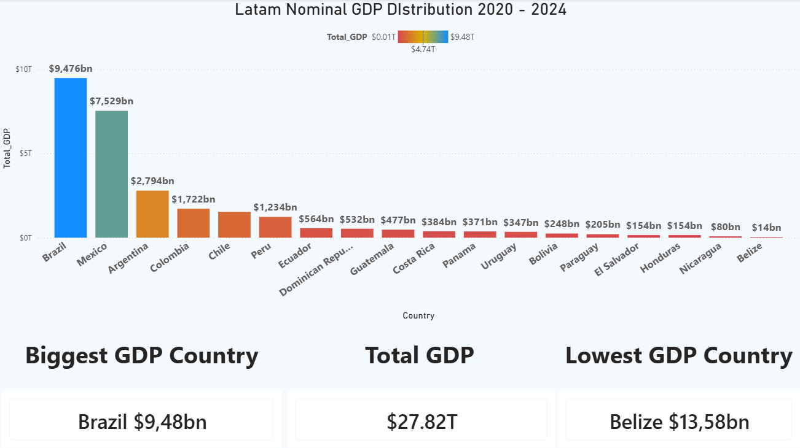

## Technical objective

Build a re-runnable pipeline that pulls two World Bank indicators for 18 Latin American countries, loads them into SQL Server and serves a Power BI report through a single analytical view.

## Case context

How do Latin American economies compare after 2020? Nominal GDP shows **scale**; real GDP growth shows **momentum**. Looking at both avoids ranking countries on size alone. Data: public World Bank figures, 2020–2024.

## Solution


1. **Extract** — Python (`requests`) calls the World Bank REST API for nominal GDP in current US$ (`NY.GDP.MKTP.CD`) and annual real GDP growth (`NY.GDP.MKTP.KD.ZG`), for 18 ISO3 country codes.
2. **Transform** — pandas flattens the JSON response, keeps country, year and value, casts types and drops empty records.
3. **Load** — SQLAlchemy + pyodbc write both datasets to SQL Server tables (full reload on each run).
4. **Model** — the view `vw_fact_gdp_latam` exposes both indicators to Power BI as one analytical layer.
5. **Measure** — DAX ranks countries with `RANKX` over `ALL(Country)`, so rankings stay correct when a visual is filtered, and builds formatted KPI cards for the leader, total and lowest values.

```dax
Ranking_Growth =
RANKX ( ALL ( vw_fact_gdp_latam[Country] ), [Global_Growth_%], , DESC )
```

## Tools used

Python (requests, pandas, SQLAlchemy, pyodbc) · SQL Server (T-SQL view) · Power BI (DAX)

## Result

Two dashboards built on the same model.


- **Growth** (sum of the annual real growth rates, 2020–2024): Nicaragua ranks #1 at 19.78% and Bolivia #18 at 2.45%. The 18-country average is 12.28%.



- **Scale** (cumulative nominal GDP, 2020–2024): the region totals $27.82T. Brazil ($9.48T) and Mexico ($7.53T) lead; Belize ($13.6B) is the smallest.
- **Takeaway:** the fastest-growing economies (Nicaragua, Panama, Dominican Republic, Costa Rica) are among the smallest, so size and momentum rank countries very differently.
