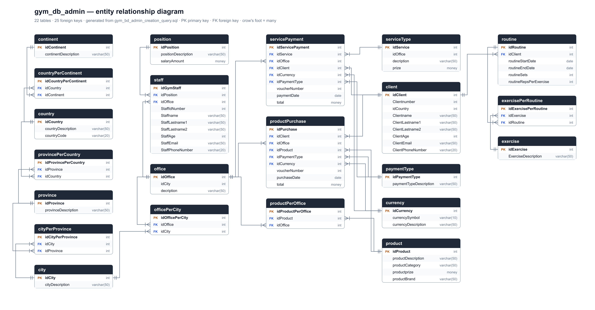

## Technical objective

Design a normalized relational schema for a simulated multi-office gym, then write analytical queries that report on it.

## Case context

Clients, offices, staff, memberships, products, services and payments need one consistent source of data. That source must answer revenue questions by service type, office and payment method.

## Solution



1. **Model** — entities with primary and foreign keys, a location hierarchy (city → province → country → continent) and lookup tables for payment type, service and staff role.
2. **Query** — a CTE joins service payments with service type, office, client and payment type into one clean dataset.
3. **Aggregate** — revenue (`SUM`) and number of payments (`COUNT`) by service type, ordered by revenue.

```sql
WITH SALES_SUMMARY AS (
    SELECT ST.decription AS ServiceType, O.decription AS Office,
      CONCAT(C.Clientname,' ', C.ClientLastname1,' ',C.ClientLastname2) AS Client,
      PT.paymentTypeDescription AS PaymentType, SP.total AS Total
    FROM servicePayment AS SP
    INNER JOIN serviceType AS ST ON SP.idService = ST.idService
    INNER JOIN office AS O ON SP.idOffice = O.idOffice
    INNER JOIN client AS C ON SP.idClient = C.idClient
    INNER JOIN paymentType AS PT ON SP.idPaymentType = PT.idPaymentType
)
SELECT ServiceType, SUM(Total) AS TotalRevenue, COUNT(*) AS TotalPayments
FROM SALES_SUMMARY
GROUP BY ServiceType
ORDER BY TotalRevenue DESC;
```

## Tools used

SQL Server (T-SQL: DDL, constraints, JOINs, CTEs, aggregations)

## Result


- Revenue by service: Physiotherapy $24,000, Personal Training $20,000, Nutrition $16,000, Group Class $12,000 and Membership $10,000, with 200 payments each.
- The same tables feed the [Gym Admin BI Report](../gym-admin-report/).
